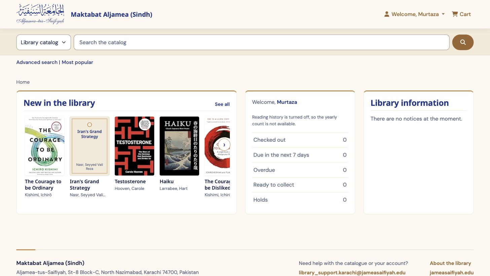

# Library-AJSK-Koha-Upgrades

Customisations for the Koha catalogue of **Maktabat Aljamea (Sindh)**, the Aljamea-tus-Saifiyah library in Karachi (Koha library code `AJSK`). Everything here sits on top of a stock **Koha 25.11.02** install with Zebra search. No Koha source file is modified: the work lives in system preferences, HTML customisations, reports, notices and circulation rules, so Koha upgrades stay safe.



## What's in this repository

| Area | Folder | In short |
| --- | --- | --- |
| OPAC and self-checkout front end | [`opac/`](opac/) | A redesigned public catalogue and self-checkout kiosk: theme, fonts, login wording, and three home-page widgets ("New in the library", a "My library" account card, "Library information") |
| Click & Collect | [`click-and-collect/`](click-and-collect/) | Readers order a book online and collect it from a desk. Built on ordinary Koha item-level holds, with a staff pull list, branded notices and shelf slips |
| Server | [`server/plack/`](server/plack/) | Runbook and commands for routing the OPAC through Plack instead of CGI |
| Tests | [`tests/opac-harness/`](tests/opac-harness/) | A stand-in Koha OPAC and Playwright checks covering function and layout at five viewports |
| Design notes | [`docs/design/`](docs/design/), [`docs/screenshots/`](docs/screenshots/) | Sites used for inspiration and screenshots of the OPAC at several widths |

```
.
├── opac/
│   ├── current/            what is installed today: CSS v4, JS v4, HTML blocks, build.js, INSTALL.md
│   └── legacy/             earlier versions, kept for reference and rollback
│       ├── v1/             first stylesheets (V1 to V1.5) and the original theme
│       ├── v2/             first widgets, JS v1 and v1.2, plus early widget drafts
│       └── v3/             CSS and JS v3, masters and paste copies
├── click-and-collect/      project log, settings backup, OPAC and staff JS, report SQL, notice templates
├── server/plack/           Plack enablement runbook and shell commands
├── tests/opac-harness/     serve.py stand-in OPAC, fixtures, Playwright tests
└── docs/
    ├── design/             inspiration notes
    └── screenshots/        OPAC home page and self-checkout captures
```

## 1. OPAC and self-checkout front end

Install guide: [`opac/current/INSTALL.md`](opac/current/INSTALL.md).

Seven pieces are pasted into Koha's staff interface. None of them needs server access.

| File | Goes into |
| --- | --- |
| `OpacHeaderFonts_V2.html` | HTML customizations › `opacheader` |
| `OpacLoginInstructions_V1.html` | HTML customizations › `OpacLoginInstructions` |
| `OpacMainUserBlock_V3.html` | HTML customizations › `OpacMainUserBlock` |
| `OPACUserCSS_V5.paste.css` | System preference `OPACUserCSS` |
| `OPACUserJS_V5.paste.js` | System preference `OPACUserJS` (Parts 0–D; keep the Click & Collect Part E after them) |
| `SCOUserCSS_V1.paste.css` | System preference `SCOUserCSS` |
| `SCOUserJS_V1.paste.js` | System preference `SCOUserJS` |

Each stylesheet and script comes in two forms. The plain file (`OPACUserCSS_V5.css`) is the documented master, which you edit. The `.paste` file is the same code with comments stripped. Koha prints these preferences inline on every page, so stripping the comments saves about 13 KB gzipped per page view. To regenerate the paste copies after editing a master:

```bash
cd opac/current
npm install terser css-tree
node build.js
```

The build refuses to write a file that does not parse.

**Highlights**

- **Three home-page widgets** in one card grid: a shelf of new, in-stock titles (filtered with `not notforloan=3`, with a fallback if Zebra rejects the term); a "My library" card showing loans, items due within 7 days, overdues, holds, charges and books borrowed this academic year in both Hijri and Gregorian dates; and a "Library information" panel that staff maintain through Koha News, with expiry dates.
- **Uses the whole page.** It hides Koha's empty `col-lg-3` column, which takes the widget row from 1002px to 1344px at 1440px wide. The layout is responsive, and the account card comes first on small screens.
- **Self-checkout kiosk styling** (`SCOUserCSS`/`SCOUserJS`) for a 1080×1920 portrait touchscreen, including ITS number masking.
- **Loading rosette fix**: the overlay is pinned to `window.visualViewport`, so it stays visible after pinch-zoom on phones and kiosks.

## 2. Click & Collect

Start with the project log: [`click-and-collect/00-project-log-status-rollback-and-migration.md`](click-and-collect/00-project-log-status-rollback-and-migration.md). It records the design, every setting changed (with its old value), the rollback steps and how to move the system to another Koha.

- Every hold link on the OPAC becomes **Click & Collect**, **Reserve** (when every copy is on loan) or **Ordered ✓**, decided per title from Koha's public REST API.
- A short dialog asks only *when*: as soon as possible, or a date up to 7 days ahead. The ready time is worked out from opening hours, the copy is picked automatically, and the right collection desk is shown.
- After placing the order, the script confirms it against the reader's real holds list, because the connection sometimes drops Koha's response even when the order was saved.
- A new not-for-loan code, **-2 "Collect & read in library"**, lets reference books be ordered without being borrowable.
- For staff: report 34 lists the orders to pull, grouped by desk, and a **Print pull list (PDF)** button prints it. Branded email notices and a shelf slip that prints only the ITS number and last name complete the loop.

| File | Purpose |
| --- | --- |
| `01-backup-of-koha-settings-before-changes-2026-10-29.md` | Settings, circulation rules and notice text before any change |
| `02-opac-userjs-click-and-collect-buttons-and-dialog.js` | OPACUserJS "Part E": buttons, dialog, ordering |
| `03-staff-userjs-print-pull-list-pdf-button.js` | IntranetUserJS: print button on report 34 |
| `04-report-34-orders-to-pull-sql.sql` | SQL for the pull list report |
| `05-email-notices-and-shelf-slip-templates.md` | Order-received email, ready email and shelf slip |

Requires Koha 23.11+ and the Bootstrap 5 OPAC.

## 3. Plack

[`server/plack/Plack-enable-runbook.md`](server/plack/Plack-enable-runbook.md) explains a common trap. `koha-plack --start` starts the Starman daemon, but only `koha-plack --enable` plus an Apache reload routes requests to it. Until both are done, every page is still served by CGI. [`plack-commands.sh`](server/plack/plack-commands.sh) gives the diagnose → back up → enable → verify sequence. Nothing in it deletes anything.

## 4. Test harness

See [`tests/opac-harness/README.md`](tests/opac-harness/README.md). It runs 60 functional and 62 layout checks against both the documented masters and the paste copies, at 1440px, 834px, 390px, iPhone 13 and a 1080×1920 kiosk.

## Environment

- Koha 25.11.02, Debian package install (`koha-common`), Zebra
- OPAC: `library-karachi.jameasaifiyah.org`, behind Cloudflare
- Bootstrap 5 OPAC theme, Font Awesome 6

## Author

Murtaza Najmi, Maktabat Aljamea, Karachi.
